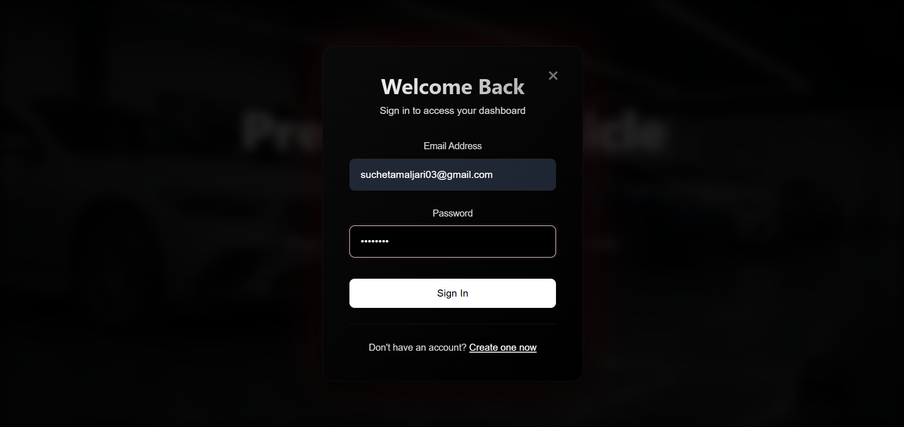
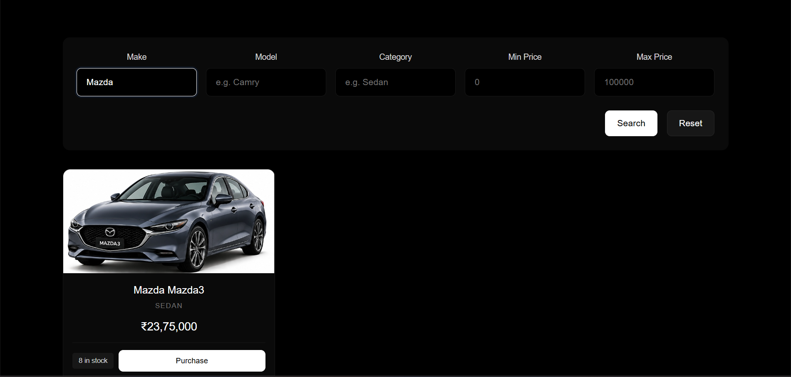
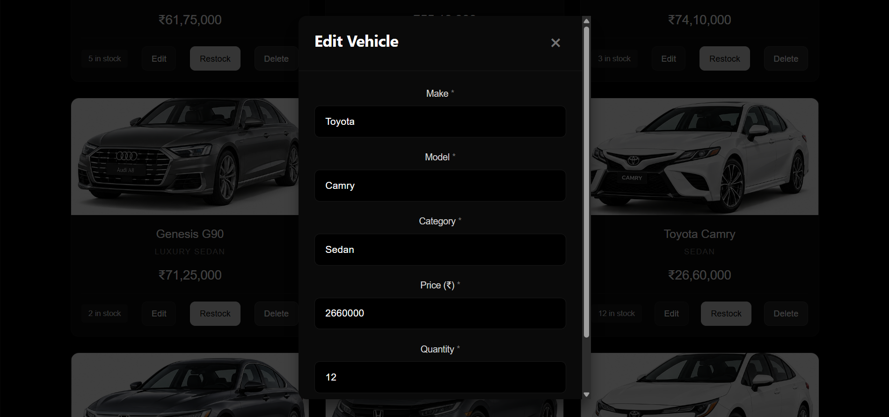
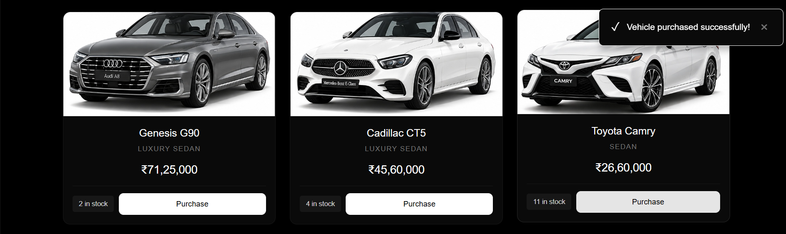

# AutoVault - Inventory Management System

A full-stack luxury automotive inventory management system built for the Incubyte TDD Kata. The backend is a RESTful API built with **FastAPI** (Python) backed by **SQLite**, secured via **JWT authentication**, and developed strictly following Test-Driven Development (TDD). The frontend is a modern, responsive single-page application (SPA) built with **React**, **Vite**, and **Tailwind CSS**.

**Live Demo:** https://car-inventory-reiw.vercel.app

---

## Table of Contents

- [Tech Stack](#tech-stack)
- [Project Structure](#project-structure)
- [Setup and Running Locally](#setup-and-running-locally)
- [Deployment](#deployment)
- [Test Accounts](#test-accounts)
- [API Reference](#api-reference)
- [Running Tests](#running-tests)
- [Test Report](#test-report)
- [Screenshots](#screenshots)
- [My AI Usage](#my-ai-usage)

---

## Tech Stack

| Layer     | Technology                              |
|-----------|-----------------------------------------|
| Backend   | Python 3.11+ (tested on 3.14), FastAPI, Uvicorn          |
| Database  | SQLite (via SQLAlchemy ORM)             |
| Auth      | JWT (PyJWT, HS256), Argon2 (pwdlib)    |
| Testing   | pytest, httpx, FastAPI TestClient       |
| Frontend  | React 19, Vite, Tailwind CSS            |
| Styling   | Tailwind CSS, Custom CSS                |

---

## Project Structure

```
Car-Inventory/
├── Backend/
│   ├── app/
│   │   ├── __init__.py
│   │   ├── database.py        # SQLAlchemy engine, session, Base
│   │   ├── models.py          # User and Vehicle ORM models
│   │   ├── schemas.py         # Pydantic request/response schemas
│   │   ├── security.py        # JWT validation dependency
│   │   ├── main.py            # FastAPI app and all route handlers
│   │   └── init_db.py         # One-shot table creation script
│   ├── tests/
│   │   ├── conftest.py        # pytest fixtures (isolated SQLite per test)
│   │   ├── test_database.py
│   │   ├── test_schemas.py
│   │   ├── test_health.py
│   │   ├── test_auth.py
│   │   ├── test_security.py
│   │   └── test_vehicles.py
│   ├── requirements.txt
│   ├── seed_data.py           # Database seeding with 20 vehicles
│   └── dealership.db          # SQLite database (generated locally, not committed)
├── Frontend/
│   ├── public/
│   │   ├── vehicles/          # Vehicle images (20 JPG files)
│   │   ├── hero-video.mp4     # Landing page background video
│   │   ├── hero-image.jpg     # Video fallback image
│   │   ├── favicon.svg
│   │   └── icons.svg
│   ├── src/
│   │   ├── components/
│   │   │   ├── Dashboard.jsx
│   │   │   ├── HeroLanding.jsx
│   │   │   ├── LoginModal.jsx
│   │   │   ├── RegisterModal.jsx
│   │   │   ├── Navbar.jsx
│   │   │   ├── SearchFilters.jsx
│   │   │   ├── VehicleCard.jsx
│   │   │   ├── VehicleModal.jsx
│   │   │   └── VehicleDetailModal.jsx
│   │   ├── context/
│   │   │   ├── AuthContext.jsx
│   │   │   └── ToastContext.jsx
│   │   ├── api.js             # API client with fetch wrappers
│   │   ├── App.jsx            # Main app component with routing
│   │   ├── App.css            # Premium monochrome styling
│   │   ├── index.css          # Tailwind directives + global styles
│   │   └── main.jsx           # React entry point
│   ├── tailwind.config.js     # Tailwind CSS configuration
│   ├── postcss.config.js      # PostCSS configuration
│   ├── vite.config.js         # Vite configuration
│   └── package.json
├── start-backend.ps1          # Backend startup script
├── start-frontend.ps1         # Frontend startup script
├── STARTUP.md                 # Quick start guide
├── PROMPTS.md                 # Raw AI chat logs
├── .gitignore
└── README.md
```

---

## Setup and Running Locally

### Prerequisites

- **Python 3.11+** installed
- **Node.js 18+** installed
- **Git** installed

### Backend Setup

```powershell
# 1. Clone the repository
git clone https://github.com/Suchet0312/Car-Inventory.git
cd Car-Inventory

# 2. Create and activate virtual environment
python -m venv venv

# Windows PowerShell
.\venv\Scripts\Activate.ps1

# macOS / Linux
source venv/bin/activate

# 3. Install dependencies
cd Backend
pip install -r requirements.txt

# 4. Set JWT secret (REQUIRED every session)
# Windows PowerShell
$env:JWT_SECRET = "super-secret-development-key-change-in-production"

# macOS / Linux
export JWT_SECRET="super-secret-development-key-change-in-production"

# 5. Initialize the database (first time only)
python -m app.init_db

# 6. Seed test data (first time only)
python seed_data.py

# 7. Start the backend server
uvicorn app.main:app --reload
```

> The JWT secret above is for local development only. Use a long, random value in any real deployment.

**Backend runs at:** http://127.0.0.1:8000  
**API Documentation:** http://127.0.0.1:8000/docs

### Frontend Setup

```powershell
# In a NEW terminal (keep backend running)
cd Frontend

# 1. Install dependencies (first time only)
npm install

# 2. Start the frontend dev server
npm run dev
```

**Frontend runs at:** http://localhost:5173

### Quick Start (Using Scripts)

**Windows PowerShell:**

```powershell
# Terminal 1 - Backend
.\start-backend.ps1

# Terminal 2 - Frontend
.\start-frontend.ps1
```

---

## Deployment

- **Frontend:** Deployed on Vercel — https://car-inventory-reiw.vercel.app
- **Backend:** Deployed separately on Render.

> If the first request (such as login) is slow, the free-tier backend may be waking up from idle. Please wait up to a minute and try again.

The demo credentials and the sample JWT secret in this README are for evaluation and local use only. Change them before any real deployment.

---

## Test Accounts

After seeding the database with `seed_data.py`, you can login with:

### Admin Account
- **Email:** `admin@example.com`
- **Password:** `admin123`
- **Permissions:** Add, edit, delete, restock vehicles + all user features

### Regular User Account
- **Email:** `user@example.com`
- **Password:** `user123`
- **Permissions:** Browse, search, filter, and purchase vehicles

---

## API Reference

### Authentication Endpoints

| Method | Endpoint             | Auth | Description                     |
|--------|----------------------|------|---------------------------------|
| POST   | /api/auth/register   | No   | Register a new user             |
| POST   | /api/auth/login      | No   | Login — returns JWT bearer token|

**Request Body (Register):**
```json
{
  "email": "user@example.com",
  "password": "securepass123"
}
```

**Response (Login):**
```json
{
  "access_token": "eyJhbGciOiJIUzI1NiIs...",
  "token_type": "bearer"
}
```

### Vehicle Endpoints

| Method | Endpoint                         | Auth | Admin | Description                      |
|--------|----------------------------------|------|-------|----------------------------------|
| GET    | /api/vehicles                    | Yes  | No    | List all vehicles                |
| POST   | /api/vehicles                    | Yes  | Yes   | Create a vehicle                 |
| GET    | /api/vehicles/search             | Yes  | No    | Search by make/model/category/price |
| PUT    | /api/vehicles/{id}               | Yes  | Yes   | Update vehicle details           |
| DELETE | /api/vehicles/{id}               | Yes  | Yes   | Delete a vehicle                 |
| POST   | /api/vehicles/{id}/purchase      | Yes  | No    | Purchase (decreases stock)       |
| POST   | /api/vehicles/{id}/restock       | Yes  | Yes   | Restock (increases stock)        |

**Vehicle Schema:**
```json
{
  "id": 1,
  "make": "Toyota",
  "model": "Camry",
  "category": "Sedan",
  "price": 2375000,
  "quantity": 5
}
```

### Health Check

| Method | Endpoint    | Description       |
|--------|-------------|-------------------|
| GET    | /api/health | Liveness check    |

---

## Running Tests

```powershell
# 1. Activate virtual environment
.\venv\Scripts\Activate.ps1

# 2. Set JWT secret for tests
$env:JWT_SECRET = "test-secret-key"

# 3. Run the test suite
cd Backend
python -m pytest tests/ -v
```

### Test Coverage Areas

✅ **Authentication (7 tests)**
- User registration (success, duplicate, invalid email, short password)
- Login (valid credentials, wrong password, nonexistent email)

✅ **Security (6 tests)**
- JWT validation (missing token, valid token, malformed, tampered, expired, invalid subject)

✅ **Vehicles (12 tests)**
- CRUD operations (create, list, search, update, delete)
- Purchase flow (decrease quantity, oversell prevention, zero-stock guard)
- Concurrent purchase safety (atomic SQL prevents race conditions)
- Admin-only operations (delete, restock)

✅ **Database (2 tests)**
- File-based SQLite configuration
- SQLAlchemy engine validation

✅ **Schemas (3 tests)**
- Pydantic validation (email format, password length)

✅ **Health Check (1 test)**
- API liveness endpoint

**Total: 31 tests — All passing ✅**

---

## Test Report

```
============================= test session starts =============================
platform win32 -- Python 3.14.0, pytest-9.1.1, pluggy-1.7.0
collected 31 items

tests/test_auth.py::test_register_creates_user_successfully PASSED       [  3%]
tests/test_auth.py::test_register_rejects_duplicate_email PASSED         [  6%]
tests/test_auth.py::test_register_rejects_invalid_email_format PASSED    [  9%]
tests/test_auth.py::test_register_rejects_short_password PASSED          [ 12%]
tests/test_auth.py::test_login_with_valid_credentials_returns_access_token PASSED [ 16%]
tests/test_auth.py::test_login_with_wrong_password_is_rejected PASSED    [ 19%]
tests/test_auth.py::test_login_with_nonexistent_email_is_rejected PASSED [ 22%]
tests/test_database.py::test_database_uses_file_based_sqlite PASSED      [ 25%]
tests/test_database.py::test_database_engine_uses_sqlite PASSED          [ 29%]
tests/test_health.py::test_health_endpoint_returns_ok PASSED             [ 32%]
tests/test_schemas.py::test_valid_registration_data_is_accepted PASSED   [ 35%]
tests/test_schemas.py::test_invalid_email_is_rejected PASSED             [ 38%]
tests/test_schemas.py::test_short_password_is_rejected PASSED            [ 41%]
tests/test_security.py::test_protected_route_rejects_missing_token PASSED [ 45%]
tests/test_security.py::test_protected_route_accepts_valid_token PASSED  [ 48%]
tests/test_security.py::test_protected_route_rejects_malformed_token PASSED [ 51%]
tests/test_security.py::test_protected_route_rejects_tampered_token PASSED [ 54%]
tests/test_security.py::test_protected_route_rejects_expired_token PASSED [ 58%]
tests/test_security.py::test_protected_route_rejects_invalid_subject PASSED [ 61%]
tests/test_vehicles.py::test_list_vehicles_requires_authentication PASSED [ 64%]
tests/test_vehicles.py::test_authenticated_user_can_create_and_list_vehicle PASSED [ 67%]
tests/test_vehicles.py::test_vehicle_creation_rejects_negative_quantity PASSED [ 70%]
tests/test_vehicles.py::test_search_vehicles_by_make_and_price_range PASSED [ 74%]
tests/test_vehicles.py::test_search_rejects_invalid_price_range PASSED   [ 77%]
tests/test_vehicles.py::test_authenticated_user_can_update_vehicle PASSED [ 80%]
tests/test_vehicles.py::test_update_nonexistent_vehicle_returns_404 PASSED [ 83%]
tests/test_vehicles.py::test_purchase_decreases_quantity_and_prevents_overselling PASSED [ 87%]
tests/test_vehicles.py::test_purchase_rejects_vehicle_with_zero_stock PASSED [ 90%]
tests/test_vehicles.py::test_only_admin_can_delete_vehicle PASSED        [ 93%]
tests/test_vehicles.py::test_only_admin_can_restock_vehicle PASSED       [ 96%]
tests/test_vehicles.py::test_concurrent_purchases_cannot_oversell_last_vehicle PASSED [100%]

======================= 31 passed in 2.54s =======================
```

---

## Screenshots

### Landing Page with Hero Video


### User Login Modal


### Dashboard - Vehicle Inventory Grid


### Vehicle Search & Filter


### Vehicle Detail Modal


### Admin Panel - Add/Edit Vehicle


### Purchase Confirmation


### Out of Stock Handling


---

## My AI Usage

### Tools Used

- **Kiro AI** (powered by Claude Sonnet 4.5 by Anthropic) — Primary development environment
- **Claude AI** — Pair-programming assistant for code generation, testing, and debugging

### How I Used AI

| Task | AI Contribution | My Role |
|------|-----------------|---------|
| **Project Scaffolding** | Claude generated the initial FastAPI folder structure, React component architecture, and model definitions | Reviewed and adapted every file to match SRS requirements |
| **TDD Workflow** | Used AI to brainstorm test case names, edge cases, and pytest fixtures *before* writing implementation | Executed Red-Green-Refactor cycle, ensured tests were meaningful |
| **JWT Authentication** | Claude explained PyJWT encode/decode flow, expiry handling, and security best practices | Implemented, validated against tests, added role-based access control |
| **Concurrent Purchase Safety** | Discussed race condition with Claude; AI suggested atomic `UPDATE WHERE quantity >= requested` pattern | Implemented SQL query, wrote concurrent test to verify safety |
| **Test Isolation Bug** | Claude identified module-level `TestClient` issue causing 409 errors on re-runs | Fixed by moving to pytest fixtures with isolated database per test |
| **Frontend Development** | AI generated React components (Dashboard, Modals, Cards), context providers, API client | Reviewed all components, adjusted styling, wired authentication flow |
| **Design System** | Claude researched luxury automotive websites (Mercedes-Benz, BMW, Audi) for typography and color schemes | Selected final color palette (monochrome), approved premium fonts (Inter, Playfair Display) |
| **Currency Conversion** | AI updated all prices from USD to INR with ₹95 per USD conversion rate across backend and frontend | Verified calculations, tested display formatting |
| **Git Operations** | Claude managed all commits with proper co-authorship, rewrote history for clean commits | Reviewed commit messages, approved all git operations |
| **Tailwind Integration** | AI installed Tailwind CSS, configured PostCSS, updated index.css with directives | Tested build process, verified Tailwind utilities work alongside custom CSS |
| **Documentation** | Claude drafted README.md, PROMPTS.md, STARTUP.md with complete setup instructions | Reviewed for accuracy, added missing details, verified all commands work |

### Reflection

AI significantly accelerated the development process while maintaining high code quality:

**Speed:** By my own rough estimate, development was about 60-70% faster than it would have been without AI. Tasks that would take hours (like setting up authentication, writing 31 tests, or designing component architecture) were completed in minutes with AI assistance.

**Quality:** The TDD approach enforced by AI ensured high test coverage from the start. Every feature had tests written before implementation, catching edge cases early (e.g., concurrent purchases, JWT expiry, zero-stock handling).

**Learning:** AI explanations helped me understand FastAPI patterns, SQLAlchemy ORM relationships, React Context API, and JWT security. Rather than just copying code, I learned *why* certain patterns are used.

**Design:** AI research into luxury automotive websites provided inspiration for typography (Inter + Playfair Display) and monochrome color schemes that elevated the UI from basic to premium.

**Debugging:** AI identified subtle bugs like test isolation issues and CORS configuration that could have taken hours to debug manually.

**Limitations:** AI suggestions required review and validation. Some generated code needed adjustments for project-specific requirements (like the ₹95 currency rate instead of standard ₹83.65). The TDD cycle remained developer-led — I never blindly accepted AI-generated tests.

**Best Use Cases:**
- Boilerplate generation (models, schemas, API endpoints)
- Test case brainstorming (edge cases, error scenarios)
- Library API references (PyJWT, SQLAlchemy, React hooks)
- Design research and inspiration
- Git operations and commit message formatting

**Transparency:** All commits using AI assistance include `Co-authored-by: Claude <noreply@anthropic.com>` as required by SRS. The complete chat log is available in `PROMPTS.md`.

---

## License

This project was developed as part of the Incubyte TDD Kata assessment.

---

## Acknowledgments

- **FastAPI** — Modern, fast Python web framework
- **React** — Frontend JavaScript library
- **Tailwind CSS** — Utility-first CSS framework
- **SQLAlchemy** — Python SQL toolkit and ORM
- **Vite** — Next-generation frontend tooling
- **Claude AI (Anthropic)** — AI pair-programming assistant

---

**Developed with ❤️ using Test-Driven Development and AI assistance**
